<!-- SPDX-License-Identifier: GPL-3.0-only -->
# The Bryo manual

Bryo turns the M-VAVE FM-1 into a four-track instrument for sculpting sound. Each track has a **source** (a tape
loop, a synth, a sampler or a drum machine) and runs through four effects in a fixed order: **GRAIN, RIPPLE,
COLOR, CHRONOS**. Four **modulators** per track can move any knob, and an **arpeggiator** can play your chords for
you. There are no menus: you hold a pad and turn a knob.

This manual is a series of small steps. Each one does one thing, shows the screen you should see, and says what you
should hear. Do them in order the first time; after that, jump to what you need.

> The pictures are the real screens, drawn by the same code that runs on the FM-1. The values on them are the ones
> the tests set, so yours may differ a little.

**Contents**

0. [Before you start](#0-before-you-start): the panel, reading the screen, how pages work
1. [First sounds](#1-first-sounds): power on, play, tempo, volume, mutes, picking a track
2. [Playing with a tape](#2-playing-with-a-tape): slices, the loop, speed, reels
3. [The mixer](#3-the-mixer): levels, tone and pan, the compressor, the key and scale, SETUP, the CPU meter, scenes
4. [Recording](#4-recording): clear a track, record onto it, overdub, undo
5. [Other sources](#5-other-sources): SYNTH, POLY and DRUM; the arpeggiator; the black keys as notes
6. [The effects](#6-the-effects): GRAIN, RIPPLE, COLOR, CHRONOS
7. [Modulation](#7-modulation): make knobs move by themselves
8. [Getting back](#8-getting-back): reset a knob or a page, undo
9. [Saving](#9-saving): projects, a blank project, the factory scene, track presets
10. [With a computer](#10-with-a-computer): files over USB, recording the computer
11. [When something goes wrong](#11-when-something-goes-wrong)
12. [Quick reference](#12-quick-reference)

---

## 0. Before you start

### 0.1 The panel

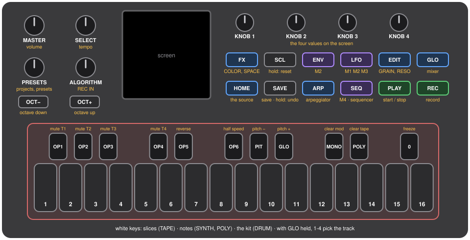

- **Top left**, four labelled knobs: **MASTER** (volume), **SELECT** (tempo), **PRESETS** (projects and presets),
  **ALGORITHM** (what REC records). Under them, **OCT−** and **OCT+**.
- **Top right**, **KNOB 1 to 4**: they always change the four values on the screen.
- **The pads**, two rows:
  - **Blue: the pages.** HOME (the track's source), EDIT (GRAIN, RIPPLE), FX (COLOR, CHRONOS), GLO (the mixer).
  - **Purple: the modulators and the envelope.** LFO holds three you can swap around (M1, M2, M3), SEQ is M4, the
    step sequencer. **ENV** shapes the track's sound: SYNTH's and POLY's envelope and filter, TAPE's slices',
    DRUM's KIT. Those pages live only there; HOME has the rest of the source.
  - **ARP** is the arpeggiator.
  - **Green: the transport.** PLAY and REC.
  - **SAVE** saves (held: undo). **SCL** held resets things.
- **The keys:** 16 white keys play the track. The 11 black keys above them have their own jobs (mutes, reverse,
  clears, freeze), written above each one in the picture.

### 0.2 Reading the screen

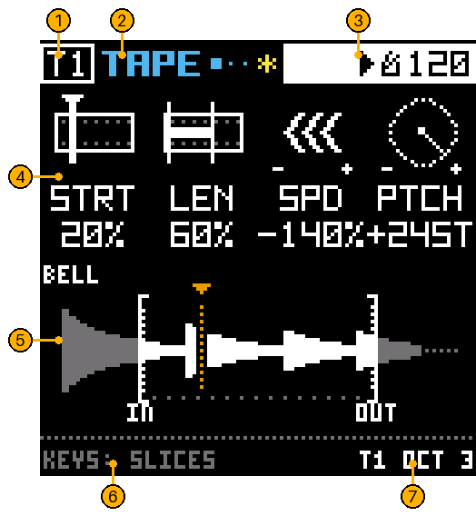

1. **The track** you're on: T1 to T4. (On a modulator's page it says M1 to M4, the slot.)
2. **The page's name**, and dots for which of its pages you're on (TAPE has four: `▪···` is the first).
3. **The transport and the tempo.** ■ stopped, ▶ playing, ● armed to record; then the tempo (120 BPM). A **✱**
   before them means you've changed something since you last saved (see 0.3); most pictures in this manual show it.
4. **The four knobs.** A little picture, a name, a value. KNOB 1 is the left one, KNOB 4 the right one. The last
   one you turned has its name inverted.
5. **The picture** of what the page does: here the tape, with the loop bracketed (IN and OUT) and the play head.
6. **What the white keys do** on this page (here: play slices).
7. **The track again, and the octave** of the white keys.

**Colour.** The screen is white on black, and colour only ever says two things: where you are, and what's alive.
Everything it says is also said by a shape or a word, so you never need to tell the colours apart.

| Colour | Means |
| --- | --- |
| **Blue** page name | a page of the blue pads (HOME, EDIT, FX, GLO) |
| **Purple** page name | a modulator's page (LFO, SEQ, ENV, ARP); a knob a modulator moves (its corner mark and the rail under it), and its depths while you hold a modulator's pad |
| **Orange** | sound happening now: grains playing, strings ringing, the room or echoes sounding, the note or step playing, the tape's playhead running, the mixer's meters |
| **Red** | recording (the tempo bar, the REC tag); the CPU reading near its limit |
| **Yellow** | something to know: not saved (the ✱), FROZEN, grains HELD |

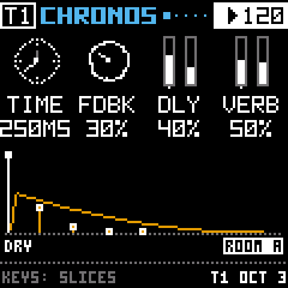 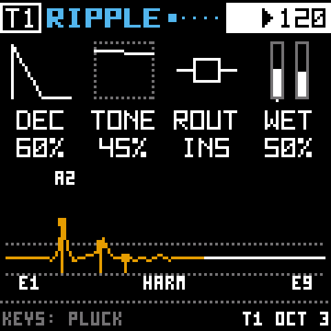

### 0.3 How pages work

Every pad opens a page, and **pressing the same pad again goes to its next page**. Then it goes round to the first.

| Pad | Pages, in order |
| --- | --- |
| HOME | the source's pages (TAPE has 4; SYNTH 4; POLY 4; DRUM 3) |
| EDIT | GRAIN 1-6, then RIPPLE 1-5 (RESO and 12-BAND: 1-6) |
| FX | COLOR 1-3, then CHRONOS 1-4 |
| ENV | the source's shaping pages: SYNTH's and POLY's AMP and FILTER, TAPE's slice envelope, DRUM's KIT and KIT 2 |
| LFO, SEQ | a modulator's pages (LFO: M1, M2 or M3; SEQ: M4) |
| ARP | the arpeggiator: 2 pages, then RIPL ARP (RIPPLE's own arpeggio) |
| GLO | the mixer (EDIT then steps CHANNEL, MASTER, KEY, SETUP) |

KNOB 1 to 4 always change the four values you see. There's nothing hidden.

**Jump straight to a page: hold its pad and press a white key.** While you hold a pad (HOME, EDIT, FX, ENV, LFO,
SEQ or ARP), the white keys show its pages: one glows for each page, the page on screen is lit, and every other key
goes dark. Press white key 3 to go to the third page. EDIT's keys run through GRAIN's pages and then RIPPLE's
(key 8 is RIPPLE 2); FX's through COLOR's and then CHRONOS's. Every effect's first page ends with its mix:
**ROUT** on KNOB 3 and **WET** on KNOB 4 (CHRONOS: **DLY** and **VERB**, its two sends), so one press of EDIT or FX
and KNOB 4 brings an effect in. Holding LFO also lights OP1-OP3, the one it's on
bright. Let go without pressing a key and the pad turns its page as usual.

### 0.3 Saving, in short

- **Nothing is kept until you tap SAVE.** The **✱** in the header says there are changes you haven't saved; it goes
  away when you save.
- **Tap SAVE:** everything goes into the current project (**P1** to start with). Turn the FM-1 off and on and it's
  all back.
- **Hold SAVE:** undo. It brings back the last thing you cleared, reset or loaded (a tape, a drum pattern, a
  track's modulation, a page you reset, a preset you loaded).
- **Holding the black POLY key for half a second clears things:** the track's tape (on DRUM, its pattern; on an ARP
  page, the notes it holds). The screen says "KEEP HOLDING POLY TO CLEAR..." first; let go then and nothing happens.
- **Lost something that SAVE held can't bring back?** If you haven't saved since, go back to your last save: turn
  **PRESETS**, point at your project, press **OCT+**, and **OCT+** again to confirm. Everything since that save
  is gone, the lost track comes back.
- **Projects and presets:** a project (P1 to P6) is everything at once; a track preset (A to H) is one track's
  sound. Both are in [9](#9-saving).

---

## 1. First sounds

### 1.1 Turn it on

1. Turn the FM-1 on.
2. **BRYO** shows for a moment.
3. Then you're on **track 1's TAPE page**.

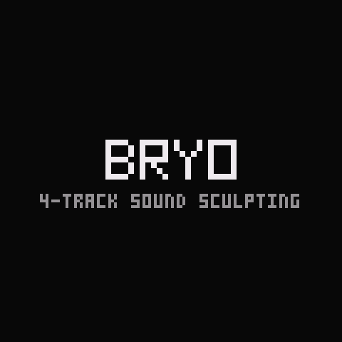 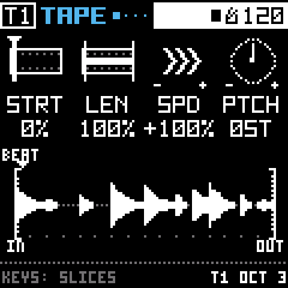

> **Don't hold OCT− and OCT+ while you turn it on.** That starts the hardware calibration (see
> [11.3](#113-a-calibration-screen)).

### 1.2 Press PLAY

1. Press **PLAY**.
2. The ■ in the header turns into ▶, and the play head moves along the tape.

**You'll hear:** the factory scene. It's one groove in A minor with three **scenes** of it, and it starts on the
first, **AMBIENT**:
- **Track 1:** a four-on-the-floor drum bar, silent here (its level is down in this scene).
- **Track 2:** a choir: **VOX** holding a minor-seventh chord (its arpeggiator on **HOLD**, no steps), with a slow
  attack and the longest release. The chord moves a bar at a time (Am, Dm, Em), and **GLID** bends it there over
  about two seconds instead of jumping.
- **Track 3:** a drone (**DRON**) through a continuous cloud of half-second grains on its own pitch, its highs
  shelved down, and four resonators that ring out while a slow **FLOW** walks the sound through them.
- **Track 4:** two bells (**BELL**) held, bowed rather than struck, their tails looping back and forth into a long
  shimmer, their echoes smeared into a dark wash.

Everything in this scene swells into existence and fades out gradually, at a slow 80 BPM: held chords instead of
arpeggios, slow attacks, the longest releases, no noise, darker filters, nothing that steps (the scene turns the
stepping modulators' **AMT** to 0, all but the chord's glide), and nothing percussive (the drums are silent here, since their kick would duck the
other tracks). All three tracks sit deep in the big room: a whole hall, long, dark and slowly moving, with a pre-delay
so the sound lands before the room blooms behind it.

**Then morph it.** Tap **GLO**, tap **EDIT** for **SCENES**, and turn **KNOB 2** to morph into **TECHNO**: the drums
come up and everything else ducks on the kick (each track has a FOLLOW of track 1 on its level), track 2 becomes a saw
bass, track 3 a high-passed pump, track 4 short stabs. **KNOB 3** morphs on into **GLITCH**: crushed drums stuttering
through grains, track 2 a resonant phase-distortion saw, track 3 stuttering through the 12-band bank, track 4 picking
its bell or a drum loop at random for every note. Tap white keys 1-3 to jump between them instead. Scene 4 is free for
your own ([3.9](#39-scenes-four-sounds-to-jump-or-morph-between)). Each scene has its own tempo too: AMBIENT 80, TECHNO 128, GLITCH 136. On the way to TECHNO the held chords start stepping again at the halfway point: scenes hold the arpeggiator too.

> If you've saved a project, it comes back at power-on instead. To hear the factory scene again, see
> [9.4](#94-back-to-the-factory-scene).

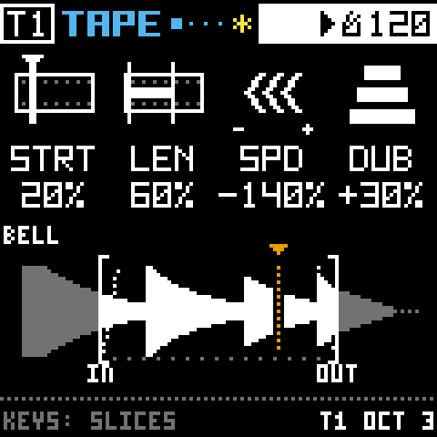

3. Press **PLAY** again to stop. Every loop starts from the top when you play again.

### 1.3 Change the tempo

1. Turn **SELECT**. It works on every page.
2. The number in the header changes (40 to 240 BPM).

The tapes keep their own speed (that's SPD, in [2.3](#23-speed-and-backwards)). The tempo drives everything that
keeps time: the drum machine, the modulators, and how many bars GRAIN holds. You'll hear it once you get there.

### 1.4 Volume

Turn **MASTER**. It's the volume of everything, on every page.

### 1.5 Mute a track

1. Press black key **OP1**: track 1 goes silent.
2. Press it again: back.
3. **OP2, OP3, OP4** do the same for tracks 2, 3 and 4.

### 1.6 Pick a track

Almost everything you do changes **the track you're on** (T1 in the header).

1. **Hold GLO.** The mixer appears.
2. While holding it, **press white key 2**. The box moves to T2.
3. Let go of GLO. You're back on the page you were on, now for **track 2** (the header says T2).

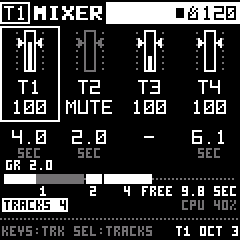

---

## 2. Playing with a tape

A **TAPE** track plays a loop. These steps work on any track whose source is TAPE (all four, to start with). Press
**PLAY** first.

### 2.1 Play slices with the white keys

The loop is cut into 16 slices, one per white key.

1. Press **HOME** to be on the TAPE page.
2. Press **white key 1**, then **white key 9**.

**You'll hear:** the loop jumps to the start (key 1), then to halfway (key 9). Tap keys in rhythm to remix it.
Stopped, a key plays its slice once.

### 2.2 Make the loop shorter

1. On the **TAPE** page, turn **KNOB 2 (LEN)** left to about 50 %.
2. The brackets on the tape close in: the loop is now half as long.
3. Turn **KNOB 1 (STRT)** to cut the start away: the loop begins there and runs **LEN** on, stopping at the tape's
   end if LEN reaches past it (so at LEN 100 STRT simply trims the front).
4. **Zoom in on an edge:** hold **HOME** and turn **STRT** or **LEN**. Each click now moves it a hundredth of a
   percent, the value shows to the hundredth in orange, and the picture becomes the sound itself around that edge
   (what plays bright, the rest dim), with its time in seconds. Let go of HOME to zoom out. Turning without HOME keeps
   the hundredths and moves in whole percents.

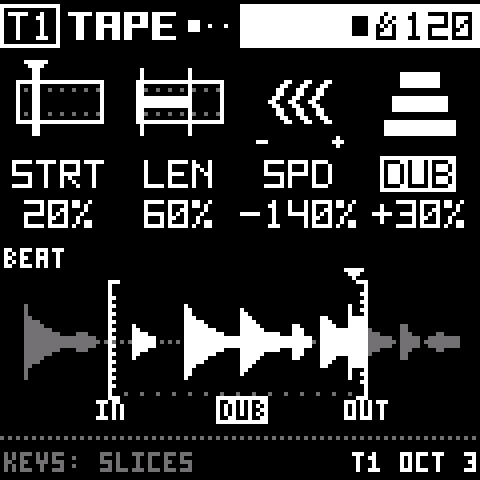 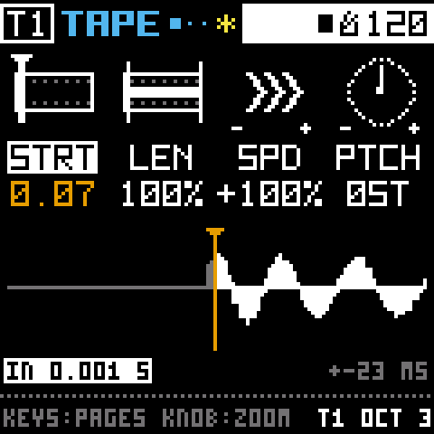

### 2.3 Speed, and backwards

1. On the **TAPE** page, turn **KNOB 3 (SPD)**. 100 % is normal speed.
2. Turn it below 0 and the tape plays **backwards**. −100 % is backwards at normal speed.

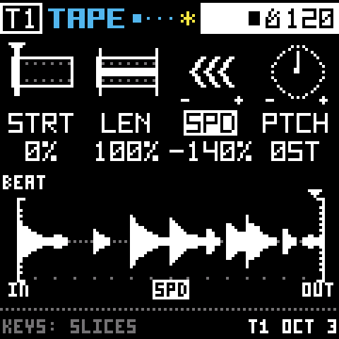

**You'll hear:** the pitch follows the speed, like a real tape.

**In tune with the keys:** **KNOB 4 (PTCH)**, beside SPD, moves the speed in semitones (−24 to +24): +12 an octave
up, +7 a fifth. SPD and PTCH multiply, so set SPD at 100 % and play PTCH like a transpose.

### 2.4 The quick ones: reverse and half speed

- Black key **OP5**: the track's tape backwards, on or off.
- Black key **OP6**: half speed, on or off.

REV is also on TAPE's page 3. Half speed is the same as PTCH −12, so it lives on OP6 only.

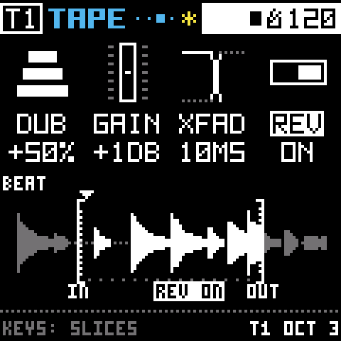

### 2.4b Shape the slices: TAPE's envelope

Press **ENV**: **ATK DEC SUS REL**, an envelope for the slices you play from the keys.

- **Stopped**, a key's slice rises over ATK, falls over DEC to SUS while you hold the key, and fades over REL when you
  let go. Out of the box it changes nothing: a tapped slice plays to its end, as before.
- **Playing**, the loop keeps going as it is; a key's jump fades in over ATK (a long ATK makes the jumps swell in).

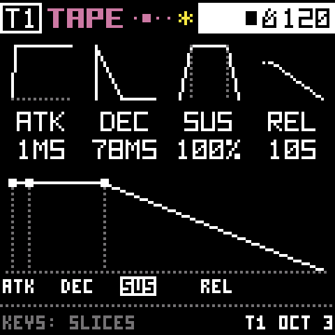

### 2.4c Freeze it, warble it: TAPE's tools

Press **HOME** to the third page: **FRZE FLEN WOW FLUT**.

- **FRZE ON** holds the moment: the head keeps looping the **FLEN** milliseconds it was in when you turned it on
  (10 ms to 1 s), framed in orange on the picture, until you turn it off and the loop plays on from there. A short
  FLEN is a buzz or a stutter, a long one a phrase on repeat. The white keys slice the frozen bit, so you can play
  it; put an LFO (square) on FRZE for a stutter that comes and goes.
- **WOW** is a slow, wandering waver of the tape's speed (and pitch), up to about a quarter tone at 100: a worn
  cassette. **FLUT** is a quick one, a flutter. Together they make an old machine's warble.

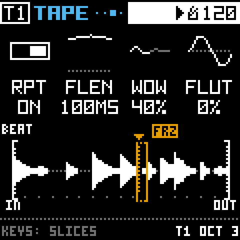

### 2.5 Play a different reel

1. Press **HOME** until the dots show the last page (the fourth).
2. Turn **KNOB 1 (REEL)**: BEAT, BELL, DRON, FOLD, then any reels you've added. **TAPE** means the track's own tape
   (what you record onto it).
3. **KNOB 2 (ROTA)** rotates the loop against the beat: turn it while it plays and the loop shifts round by that
   much at once (a quick crossfade), so the bar starts on another part of the tape; PLAY and the slice keys count
   from there too. **KNOB 4 (LVL)** is how loud the track hears its source.
4. **KNOB 3 (SYNC)** ties the loop to the tempo: pick how many bars it is (**1BR** to **16BR**) and it plays exactly
   that long at whatever tempo you set, speeding up or slowing down (and its pitch with it, like a tape machine),
   locked to the beat. A loop you record with a set number of bars ([4.3](#43-record-exactly-some-bars-for-drum-loops))
   comes with SYNC set to them. **OFF** plays it at its own speed (SPD).

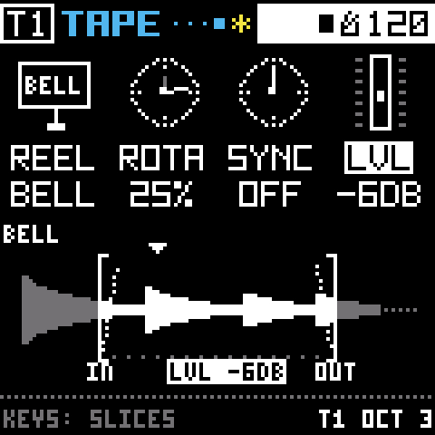

---

## 3. The mixer

### 3.1 Set the levels

1. **Hold GLO.**
2. **KNOB 1 to 4** set track 1 to 4's levels (0 to 127; 100 is the default). Each fader's fill moves with the
   sound.
3. Let go of GLO to go back.

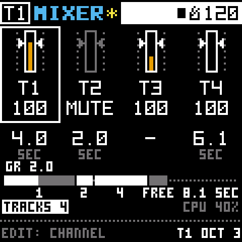

### 3.2 Keep the mixer open

**Tap GLO** (press and let go quickly). The mixer stays up, so both hands are free. Tap GLO again, or press any
page pad, to leave.

### 3.3 Tone and pan for one track

1. Open the mixer (tap GLO) and pick the track (hold GLO + white key 1-4).
2. **Tap EDIT twice** (the first is SCENES, [3.9](#39-scenes-four-sounds-to-jump-or-morph-between)). The **CHANNEL** page: **LOW** and **HIGH** (bass and treble, ±12 dB), **FILT** (left of centre
   a low-pass, right a high-pass), **PAN**.

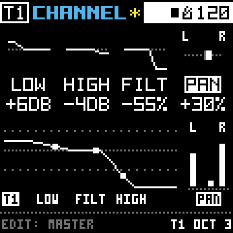

### 3.4 The master compressor

1. In the mixer, **tap EDIT three times**: the **MASTER** page.
2. **AMT** is how much it squeezes, **ATK** and **REL** how fast, **MIX** how much of it you hear.
3. Tap EDIT once more for KEY (3.6), again for SETUP (3.7), and again to get back to the levels.

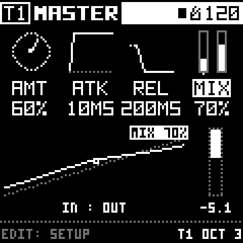

### 3.5 Fewer tracks, more memory

The four tracks share one memory (about 20 seconds of sound in all). You can switch tracks off to give the others more:

1. **Hold GLO** and turn **SELECT**: TRACKS 4, 3, 2 or 1.
2. The tracks above the number go silent and **OFF**, and their memory is free for the others.

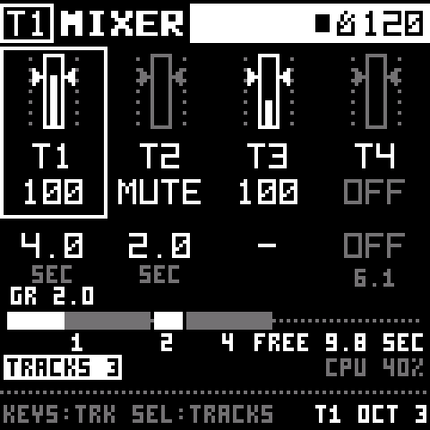

### 3.6 KEY: the project's key and scale

One key and scale for the whole project, for SYNTH and POLY (TAPE, DRUM and the effects don't use it). A new
project starts on **A MIN**, the key all the factory reels are in, and so does the factory scene.

1. Tap **GLO**, then tap **EDIT four times** (SCENES, CHANNEL, MASTER, KEY).
2. **KEY** is the key's note, C to B. **SCAL** is the scale: **OFF** (every note, as normal), then the seven modes
   **MAJ**, **MIN**, **DOR** (dorian), **PHR** (phrygian), **LYD** (lydian), **MIX** (mixolydian), **LOC** (locrian);
   **HMIN** (harmonic minor), **MMIN** (melodic minor); **PEN** (major pentatonic), **MPEN** (minor pentatonic);
   **BLUE** (the blues scale); **WHOL** (whole tone), **DIM** (diminished, whole-half) and **CHR** (chromatic, every
   note but with the key shown). The picture names the scale in full and counts its notes.
3. Play. The keys still work like a piano, but a note outside the scale plays **the nearest note in it** (between
   two, the lower one). You can't play a wrong note, and the arpeggiator follows it too.

The picture shows an octave: the scale's notes solid, the others dotted, a mark under the key's note. It's saved with
the project.

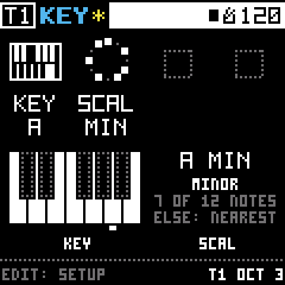

### 3.7 SETUP: how the panel behaves

The mixer's last page holds your preferences. They belong to the FM-1, not to a project, and they're kept when
you turn it off.

1. Tap **GLO**, then tap **EDIT five times** (SCENES, CHANNEL, MASTER, KEY, SETUP).
2. **KEYS**: **SHRT** (the black keys are the shortcuts: mutes, reverse, clears, freeze) or **NOTE** (the black keys
   play notes: see [5.9](#59-play-the-black-keys-as-notes)).
3. **KNOB**: how far a knob moves a value per click. **1X**, **2X**, **4X**, or **ACC** (turn slowly for fine
   steps, quickly to cover ground). Small choices, like a filter's type, always move one at a time.
4. **HOLD**: how long a pad must be held to count as held. **LEDS**: how the idle pads glow.
5. Under the two lines about the keys and knobs, two lines show **where the CPU goes**, in % of the time the FM-1
   has, averaged over the last second:
   - **SRC GRN RES COL CHR**: the four tracks' sources, GRAIN, RIPPLE, COLOR, and CHRONOS with the channel strip.
   - **PRE ROOM MST**: the work before the tracks (keys, arpeggiators, modulators), the two rooms, and the master.
   - **R/F**: how fast a fixed loop runs from fast RAM and from flash, measured once at power-on. It's there for
     tuning Bryo; together with **TEST** ([9.4](#94-back-to-the-factory-scene)) it shows what a new build changed.

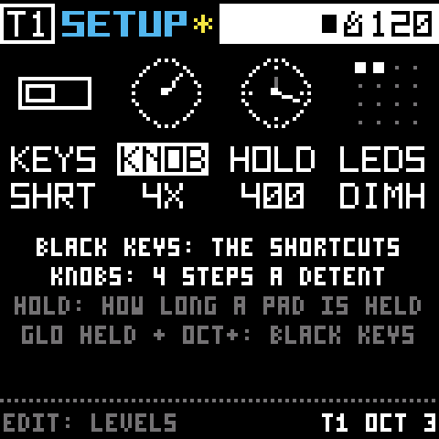

### 3.8 The CPU meter

On the mixer, bottom right: **CPU**, how hard Bryo is working, in 5 % steps. It turns bright at 85 %. Past that,
Bryo thins out grains and strings to keep the sound clean.

### 3.9 Scenes: four sounds to jump or morph between

A project has four **scenes**. Each one is a snapshot of how the project sounds: every track's source (TAPE,
SYNTH, POLY or DRUM), every knob of its sound (the source's, GRAIN, RIPPLE, COLOR, CHRONOS, the channel strip), the
track levels, the rooms, the **tempo**, the **arpeggiator's settings** (MODE, ORDR, RNGE, RATE switch at the
midpoint; GATE, SWNG, GRND, FADE morph) and each modulator's **AMT** (morphing: a scene can quiet a modulator or bring
it in). A scene doesn't hold what's playing: the tapes and reels, the drum patterns, the steps, the rest of the
modulation (the modulators' other knobs and their depths), the mutes, the notes the arpeggiators hold and the key all stay as they are when you change
scenes. So one scene can hold a chord still (HOLD) while another steps through it.

The tempo is taken when you store the scene and changes at the midpoint of a recall or a morph, the way a choice
does: it doesn't glide, since a gliding tempo would drag every synced tape and delay out of tune on the way. So a
slow ambient scene and a fast techno one can live in the same project. Scenes saved before scenes held a tempo
leave it alone; store them again to give them one.

Scenes have their own page on the mixer: open the mixer (**tap GLO**) and **tap EDIT**: **SCENES** is the first
page (then CHANNEL, MASTER, KEY, SETUP). The mixer's own page stays just the levels. A scene moves **every
track** at once, not just the one you've selected: the header's box shows the project (**P1**) here instead of a
track, as it does on MASTER and KEY, which are the project's too; only CHANNEL is the selected track's. On SCENES, the white keys
1-4 are scenes 1-4 (they don't play notes there) and each knob sits under its scene:

- **Store:** hold a scene's white key and tap **SAVE**. The sound as it is goes into that scene.
- **Recall:** tap a scene's white key. Everything glides there in about a third of a second.
- **Morph:** turn a scene's **knob**. Each detent moves 5 % of the way from where the sound was toward that scene,
  nothing held, and you can stop anywhere, so you can sit halfway between two sounds. Turn another scene's knob to
  morph from there toward that one; turn back to go back.

(Holding EDIT shows SCENES only while it's held, as GLO does the mixer, for a quick recall.)

Track by track, a scene change does one of two things:

- **The same source in both:** its knobs morph, every value moving smoothly. A choice that can't be halfway
  (RIPPLE's form, ROUT, a filter's TYPE, a room's TYPE, and the tempo) switches at the midpoint.
- **A different source:** there's no morph. The track fades out over the first half, switches to the scene's
  source and sound while it's silent, and fades back in over the second half.

The SCENES page shows each scene's box: filled for the one you last recalled, stored or morphed all the way to,
framed for a stored one, dotted for an empty one. Under each, its tracks' sources (**T S P D**, bright where a
track would change source, so it fades rather than morphs), its tempo (bright where it differs from the one
playing) and a bar of how far the sound has come toward it.
White keys 1-4 light the same way.

Scenes are saved with the project (**SAVE**). They're stored as only what differs from the project's own sound, so
they usually take little room. If a project is so full that a scene doesn't fit, SAVE keeps the project and says
which scene it couldn't keep (that one comes back empty). On the **PROJECTS** view you can see which projects have
scenes before loading them: the slot's grid box has four small marks (a stored scene filled), and the strip at the
top says how many (**2 SCENES**).

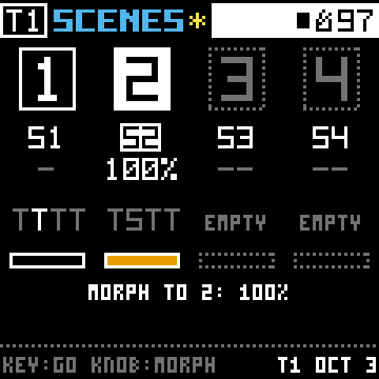 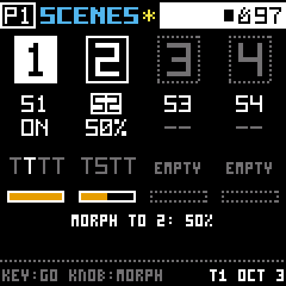 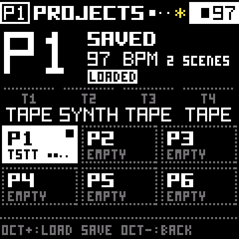

---

## 4. Recording

REC records onto **the track you're on**. On a TAPE track it records **the other tracks** playing (you can change
that: [4.6](#46-choose-what-rec-records)).

### 4.1 Clear a track's tape

1. Pick track 2 (hold GLO + white key 2).
2. **Hold black key POLY for half a second.** Track 2 is now an empty tape.

(Changed your mind? **Hold SAVE**: it comes back. See [4.5](#45-undo-a-clear).)

### 4.2 Record the others onto it

1. Press **PLAY**.
2. Press **REC**. The header shows ● and the tape grows while it records.
3. Let it run for 10 to 15 seconds, then press **REC** again.

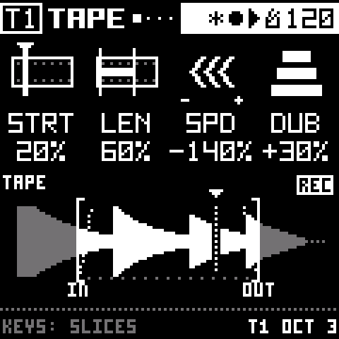

**You'll hear:** track 2 now loops what the other three played: a new loop, as long as you recorded.

### 4.3 Record exactly some bars (for drum loops)

1. **Hold REC and turn SELECT**: **FREE**, **1**, **2**, **4** or **8 BARS**. Let go: nothing is armed yet.
2. On a cleared track, tap **REC**. The header shows ● with the number of bars in front of it.
3. Press **PLAY**. Recording starts on the downbeat, and stops by itself after exactly that many bars. REC lets go,
   the screen says how long the take is, and the track loops it, in time with the tempo.

Armed while it's already playing, it waits for the next bar's downbeat. While it records, the number counts down
the bars left. Stop the transport early and you keep what it has. Turn SELECT back to FREE with REC held for the
usual way (REC again to stop). The take keeps its exact length when a project saves it into a reel.

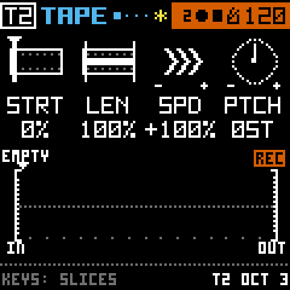

### 4.3.1 Bounce: a loop straight to tape

A SYNTH line, a POLY phrase, a DRUM pattern or a cloud of grains you want to keep as a loop:

1. **Hold REC and press PLAY.** The track records itself for the bars set in 4.3 (two, if that's on FREE) from
   the next downbeat, and the transport starts if it was stopped. Keep playing through the bars.
2. When the take is in, **the track switches to TAPE by itself** and loops it, in time, slices and all. The screen
   says "BOUNCED, 4.0 SEC ON TAPE".

A take already on the tape is cleared first (hold SAVE to get it back). On a TAPE track the bounce records the
track itself through its effects (GRAIN, RIPPLE, COLOR, CHRONOS), so a tape can be printed with its effects on it.
Tap REC before the downbeat to call it off.

### 4.3.2 Freeze to tape: the last bars, kept at once

GRAIN is always listening: with its WET up it keeps the last bars that went into it (1, 2 or 4 by how many tracks
you have) for its grains to read. **Hold REC and press black key 0** and those bars become the track's tape right
away, with no waiting for a take. It's for the moment you hear something good and it's already gone: the bars are
still in GRAIN.

The track switches to TAPE, loops those bars in time (SYNC is set to them, so it follows the tempo), and GRAIN
starts listening again with a fresh buffer. What lands on the tape is what went into GRAIN: the source as it was,
before the grains. To keep the grains too, bounce instead (4.3.1). A take already on the tape is replaced. With
GRAIN off there's nothing to keep, and the screen says so.

### 4.4 Record over a loop (overdub)

**DUB** on the TAPE page (KNOB 4) sets how much of the old recording stays when you record over it: 0 replaces it,
higher keeps more of it under the new sound.

1. On a track with a recording, set **DUB** to about +60 %.
2. Press **REC** while it plays, and **REC** again to stop.

### 4.5 Undo a clear

**Hold SAVE.** The last clear comes back: a tape, a track's modulation, or a drum pattern, whichever you cleared
last. (It only works while nothing has been recorded over it.)

### 4.6 Choose what REC records

1. Turn **ALGORITHM**. The **REC IN** page opens.
2. **KNOB 1 to 4** set what tracks 1 to 4 record:
   - **AUTO**: a TAPE track records the others; a SYNTH or POLY track records itself.
   - **OTHR**: the other tracks' mix.
   - **T1 to T4**: one track. Its own number shows as **SELF**: it records itself (resampling).
3. The lines show where each track's recording comes from. Press **HOME** to leave.

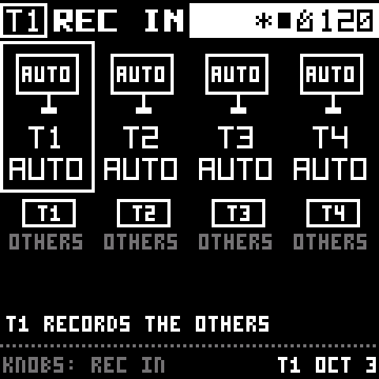 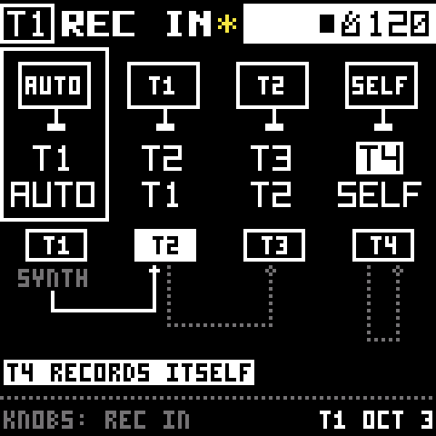

---

## 5. Other sources

Any track can be a **TAPE**, a **SYNTH**, a **POLY** (a sampler) or a **DRUM** machine. Each keeps its own knobs, so
you can switch back and forth.

### 5.1 Change a track's source

1. **Hold HOME.**
2. While holding it, **turn SELECT**: TAPE, SYNTH, POLY, DRUM.
3. Let go. You're on the new source's first page.

### 5.2 SYNTH: a small synth

Up to three notes at once. **The white keys play notes**, a semitone apart, starting from C; **OCT− / OCT+** move
them down or up an octave.

Press **HOME** again to go through its four pages, and **ENV** for its four shaping pages:

| Pad, page | Knobs |
| --- | --- |
| HOME 1, the oscillators | **WAVE** (SIN TRI SQR SAW PLS, and FM, PD, VOX and WT: below), **INTV** (the second oscillator's interval in semitones: +7 a fifth, +12 an octave, −12 a sub), **DTUN** (its detune in cents, on top), **MIX** of the two |
| HOME 2, VOICE | **VOIC** (1-3 notes), **GLID** (slides between notes), **TUNE** (semitones), **FINE** (cents) |
| HOME 3, MORE | **PW** (the pulse's width on SQR and PLS: modulate it for PWM), **NOIS**, **SUB** (a square an octave under the first oscillator, on SIN TRI SQR SAW PLS), **DRV** (drive) |
| HOME 4, LEVEL | **CHRD** (a key plays a chord: below), **TRAN** (a click at every note's start: below), **LVL** |
| ENV 1, AMP | **ATK DEC SUS REL**: how a note starts, falls, holds and fades |
| ENV 2, FILTER | **CUT** (cutoff), **RES** (resonance), **TYPE** (LP, BP, HP), **KTRK** (the cutoff follows the note) |
| ENV 3, ENV 2 | **ATK2 DEC2 SUS2 REL2**: a second envelope, for the filter (or the drive, or the pitch) |
| ENV 4, SHAPE | **ETYP** (the envelopes' type: below), the wave's own envelope depth on FM, PD, VOX and WT, **DEST** (where ENV 2 goes), **ENV** (how far, either way) |

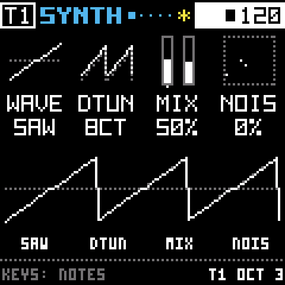 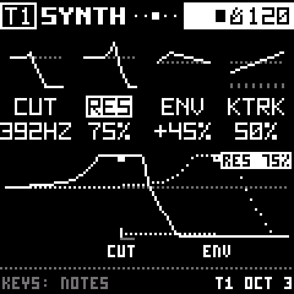
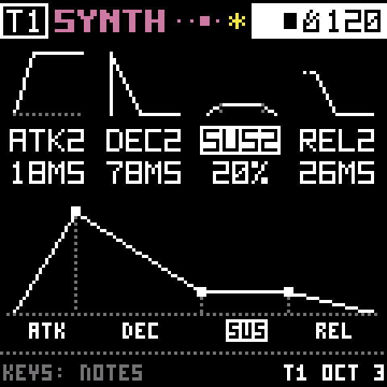 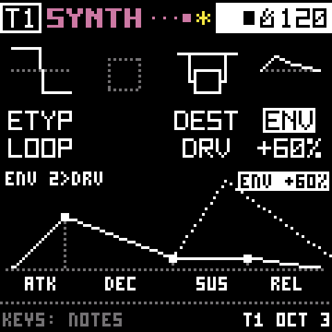
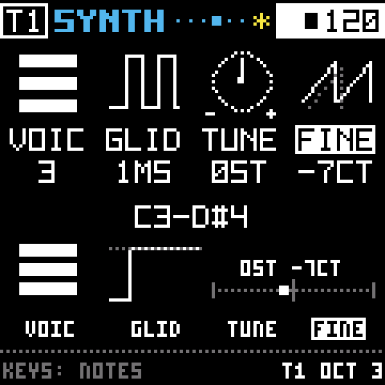

**Try:** play a note, then press **ENV** twice and turn **CUT** on the FILTER page while it sounds.

**The envelopes.** The AMP envelope sets the level; **ENV 2** is a second envelope that **ENV** sends to one place,
chosen by **DEST**:

- **CUT**: the filter opens (or, with ENV below 0, closes) as ENV 2 rises. Give it its own short decay for a pluck
  over a sustained note.
- **DRV**: a distortion envelope: the drive comes up with ENV 2, so a note can bite at the strike and turn clean as it
  holds (or, with a slow ATK2, grow gritty).
- **PTCH**: the pitch, up to two octaves either way at ENV ±100: a zap, a kick, a sweep into the note.

The FM, PD, VOX and WT waves' own envelope depth (IENV, AENV, VENV, PENV) rides ENV 2 too. **ETYP** sets both
envelopes' type:

- **ADSR**: as always.
- **AD**: a strike that dies away whatever the key does: pianos, plucks, percussion.
- **LOOP**: while you hold the key, the envelope goes round, attack and decay again and again: a pulsing, a slow swell
  and fall, or (short times) a buzzing tremolo. Let go and it releases.

**RES** past about 93 makes the filter **self-resonate**: it rings on its own at the cutoff, a pure tone that sings
over the note and follows CUT (and the envelope, and an LFO on CUT). Turn MIX and NOIS down and play it as a sine
voice, or sweep CUT for a whistle. Above 70 the filter also squashes a loud input a little into its resonance, as an
analog one does. POLY's filter does the same.

**TRAN** (HOME's last page on the classic waves, its third on FM, PD, VOX and WT; POLY's LOOP page and DRUM's KIT 2,
under ENV, have it too): a transient, 3 ms of bright noise at the start of every note or hit, as loud as the knob says. It goes in
front of the source's filter, so CUT shapes it: open, a click; low, a thump. It gives a soft sound an edge, a pad a
pick, a kit more attack through the small speaker. 0 is the sound as it was.

**CHRD** (page 6, every wave, FM and PD too): one key plays a chord on SYNTH's three voices: **MAJ**, **MIN**,
**SUS2**, **SUS4**, **DOM7**, **MAJ7**, **MIN7** (the sevenths play root, third and seventh, the way a pianist
leaves out the fifth), **DIM**, **AUG**, **5TH**, **OCT**. The lowest key you hold is the chord's root: press another
key below while holding and the chord slides there without restriking; let go of everything and it releases. The
arpeggiator plays a chord on each step. **OFF** plays notes as usual.

**FM.** Turn **WAVE** past PLS to **FM** and SYNTH becomes a two-operator FM synth (the header says **FM SYNTH**): a
second sine, the modulator, bends the first one's phase, so one knob takes it from a pure tone to bells, electric
pianos, plucks and growls. The pages relabel:

| Page | Knobs |
| --- | --- |
| 1, the operators | **WAVE** (FM), **RATI** (the modulator's pitch against the note's: 0.5, 1, 1.41, 1.5, 2 ... 14; whole numbers sound harmonic, 1.41 and the halves like bells), **INDX** (how hard it bends: 0 a sine, up for brighter and gnarlier), **IENV** (how far the envelope pushes INDX: up for a pluck, bright at the strike and mellower after) |
| 5, MORE | **FDBK** (the modulator fed back into itself: a new edge, then grit, then noise), **KTRK**, **DRV** |

AMP, FILTER, VOICE and LEVEL (CHRD, LVL) work as on every wave (open **CUT** to hear all of it). The picture draws the wave as INDX
bends it now, and dotted as it's bent at the strike.

**Try:** RATI 1, INDX 20, IENV +60, a short DEC and SUS at 0: an electric piano. RATI 3.5 or 1.41, INDX 40: a bell.

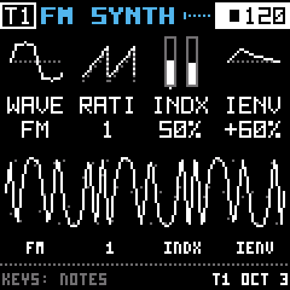

**PD.** One more turn of **WAVE** gives **PD**, phase distortion, the way Casio's CZ synths made their sound (the
header says **PD SYNTH**). A single cosine is read through a bent phase: unbent it's a pure sine, and the more it
bends the more it becomes the shape you've picked. It sounds like a filter sweep without a filter, warm and vocal.

| Page | Knobs |
| --- | --- |
| 1, the shape | **WAVE** (PD), **SHAP** (SAW, SQR, PLS, DSIN a double sine, SPLS a saw-pulse, and three resonant ones, RSAW RTRI RTRP), **AMT** (how far the phase bends: 0 a sine, 100 the whole shape; on the resonant shapes, how high the resonance sits), **AENV** (how far the envelope moves AMT: the CZ's sweep) |
| 5, MORE | **NOIS**, **KTRK**, **DRV** |

**Try:** SAW, AMT 0, AENV +80, a medium DEC and SUS at 0: the classic CZ bass sweep. RSAW with AMT turned slowly:
the resonant "wah" that made the CZ famous.

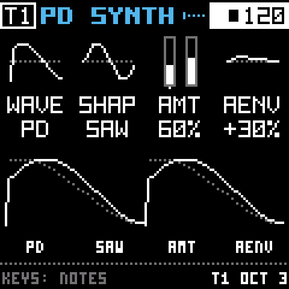

**VOX.** Past PD, **VOX** is a voice: a buzz through three formants, the resonances that make a vowel (the header
says **VOX SYNTH**).

| Page | Knobs |
| --- | --- |
| 1, the vowel | **WAVE** (VOX), **VOWL** (A E I O U, and the sounds between), **SHFT** (every formant down or up: below 0 a bigger voice, above it a smaller one), **VENV** (how far the envelope moves the vowel: "wah", "ow") |
| 5, MORE | **BRTH** (breath: noise through the same formants, a whisper at 100), **KTRK**, **DRV** |

**Try:** VOWL on U, VENV +50, a slow DEC: "ooh-wah". Turn on **CHRD MIN7** for a choir pad, and **RIPPLE** after it.

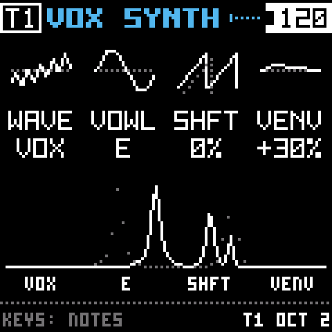

**WT.** The last wave, **WT**, is a wavetable: eight single cycles in a row, and **POS** chooses where you are
among them, morphing smoothly from one to the next (the header says **WT SYNTH**).

| Page | Knobs |
| --- | --- |
| 1, the table | **WAVE** (WT), **TABL** (the table: **BASC** sine, triangle, saw, square, pulse; **HARM** one harmonic swept up; **FORM** a resonance swept up; or any reel, **TAPE** included, cut into eight cycles), **POS** (where in it), **PENV** (how far the envelope moves POS) |
| 5, MORE | **NOIS**, **KTRK**, **DRV** |

A reel as a table: Bryo takes eight short windows evenly through it, makes each one loop, and plays them as the
cycles of a tone, so a drum loop or a voice becomes an oscillator with its grain. Record something onto the track's
tape and pick **TAPE** to play your own recording that way. The table takes a little of the shared memory (0.4 s of
the 20) while WT is on; the picture shows the eight frames stacked, the one you're on in bright ink.

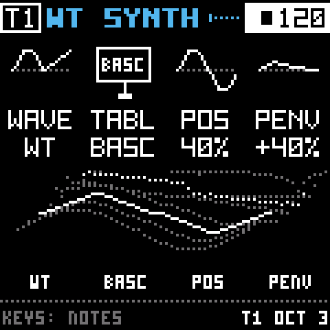

### 5.3 POLY: play a sound across the keys

POLY plays a reel (or the track's own tape) at the pitch of each key, up to four notes at once.

1. Switch the track to **POLY** (hold HOME, turn SELECT).
2. **KNOB 1 (REEL)** picks the sound. **STRT** moves where in it each note starts, **END** where it stops, **TUNE**
   shifts the pitch. Hold **HOME** and turn STRT or END to zoom in on that edge, as on TAPE
   ([2.2](#22-make-the-loop-shorter)). **VOIC**, how many notes at once, is on the last page with LVL. **TRAN**
   (page 2, with LOOP) adds a click at every note's start ([5.2](#52-synth-a-small-synth)).
   With the mixer's SCAL on, the keys stay in its scale ([3.6](#36-key-the-projects-key-and-scale)).
3. Play the white keys.
4. **Tune the sound** on the last page: **ROOT** is the note the sound was recorded at (that key plays it as it
   is), **FINE** nudges it in cents for a sound that sits between two notes. ROOT starts on **A3**, the note the
   factory reels are built on, so they play in tune with the keys straight away. For your own sounds, set ROOT to
   the note you recorded.

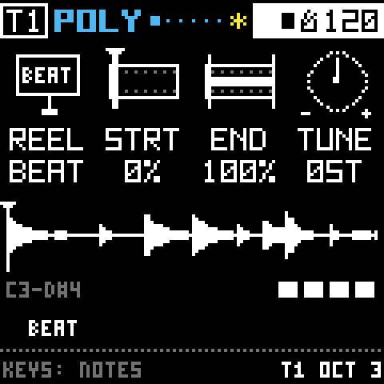 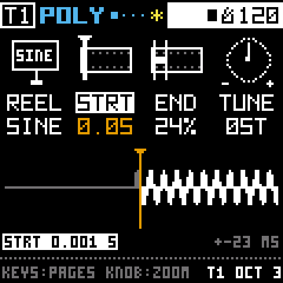

Its other HOME pages: **LOOP** (below), **TWIN** (below), **LEVEL** (VOIC ROOT FINE LVL). Under **ENV**: its envelope
(ATK DEC SUS REL), **FILTER** (CUT RES TYPE), **ENV 2** (the filter's own envelope, ATK2 DEC2 SUS2 REL2) and
**ETYP** and **ENV** (the envelopes' type, as SYNTH's, and how far ENV 2 moves the cutoff).

**LOOP: hold a note as long as you like** (page 2). Without it, a note plays from STRT to END and stops. With
**LOOP** on, a held note loops from **LSTR** (the loop's start) to **END**, and keeps looping through its release:

- **FWD**: back to LSTR each time round, with **LXF** milliseconds of fade either side of the seam to hide the jump.
- **PING**: forwards to END, backwards to LSTR, and round: seamless, good for pads and drones from short sounds.

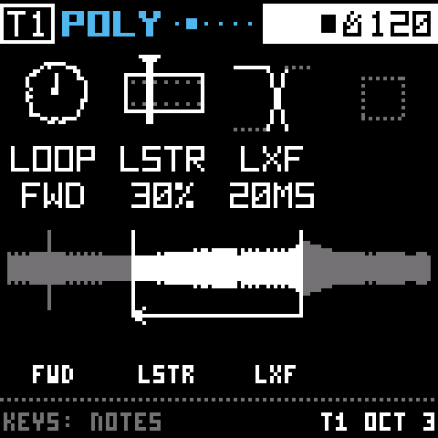

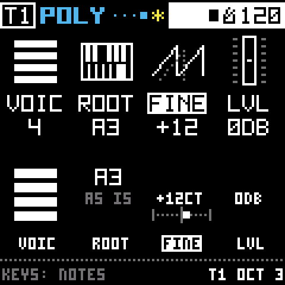

**TWIN: two sounds in one** (page 5). Give POLY a second reel, **B** (**RLB**), and **TWIN** decides how the two
play together:

- **MIX**: both at once in every note, **BLND** the balance (0 all A, 100 all B). A piano and a pad, a pluck and a
  noise. Two notes at a time in this mode (each reads two reels).
- **XFD**: the key decides: low notes A, high notes B, crossing over around middle C; **BLND** slides the crossing.
- **ALT**: round robin: one note A, the next B, so a repeated note doesn't sound like a machine gun.
- **RND**: each note picks B by chance, **BLND** the chance (0 always A, 100 always B).

**TUNB** tunes B against A in semitones (an octave up with +12). **OFF** is POLY as it was.

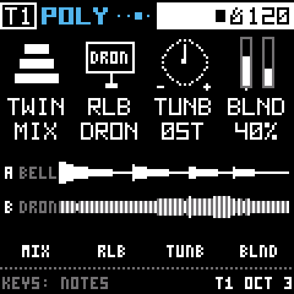

### 5.4 DRUM: a drum machine

1. Switch the track to **DRUM** (hold HOME, turn SELECT), and press **PLAY**.
2. The **PATTERN** page: **PATN** picks one of ten rhythms (ROCK, DISC, FUNK, SHFL, BOSA, RMBA, CHA, BGIN, TNGO,
   MRCH). **LEN** is 1 to 4 bars (1: a single 16-step bar), **SWNG** the swing, **ACNT** how strong the accents are.
3. The dots below show the pattern, a row per instrument.

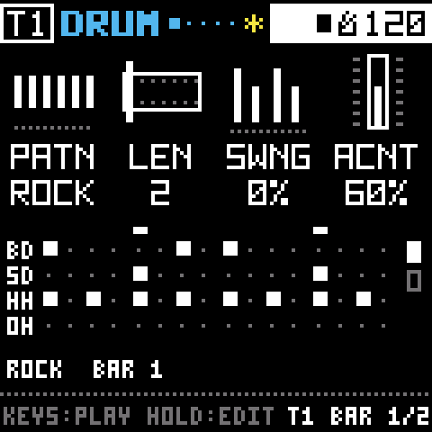

**The white keys play the kit**, left to right: bass drum, snare, clap, rim shot, low conga, low bongo, high bongo,
claves, cowbell, maracas, tambourine, guiro, hi-hat, open hat, metal beat, cymbal.

**HOME** has three pages: PATTERN, VARY and STEP (with **LVL**, the track's level of the kit, on KNOB 4). The kit's
sound is under **ENV**: **KIT** ([5.7](#57-drum-shape-one-instrument)) and **KIT 2**, which holds **TRAN**, a click on
top of every hit ([5.2](#52-synth-a-small-synth)).

### 5.5 DRUM: let it play like a drummer

1. Press **HOME** for the **VARY** page.
2. Turn **SEED** away from 0. Every number is a different version of the pattern: ghost notes, the hats thinning
   and filling, fills at the end. The same SEED always plays the same version.
3. **VARY** is how far it strays, **FILL** how often it fills, **EVOL** how often it moves on to a new version.

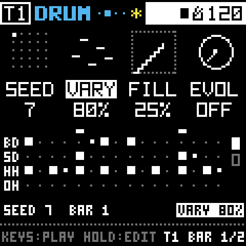

### 5.6 DRUM: write your own steps

1. Press **HOME** until the **STEP** page (the third).
2. Turn **KNOB 1 (INST)** to choose the instrument.
3. Make sure **MODE** (KNOB 3) says **HITS**.
4. Now **white key n switches step n** of the bar on or off. **OCT− / OCT+** pick the bar, and the page stays on
   that bar while the pattern plays, so you can write into it as it goes round.
5. The white keys show the bar: a step that's on is **lit**, the others glow dim. While it plays, the playhead
   flips the key it's on (a lit step blinks dim, an empty one lights), so you can see it go round. In **ACC** mode
   the lit keys are the accents.

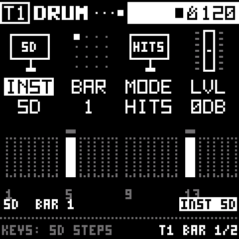

The other MODEs: **ACC** sets accents; **LIVE** lets you play along and records what you play at the nearest step;
**ERAS** wipes the instrument's hits as the play head passes while you hold a key.

To clear the whole pattern: **hold black key POLY** half a second. **Hold SAVE** to undo.

### 5.7 DRUM: shape one instrument

1. On PATTERN, VARY or KIT, **hold a white key**.
2. While holding it, KNOB 1 to 4 are **that instrument's** TUNE, DEC (length), LVL and TONE. The header shows which
   one.
3. **To modulate one of them**, keep the key held, then also hold **LFO** (or SEQ) and turn the knob: that's the
   modulator's depth to this drum's TUNE, DEC, LVL or TONE. Hold the key first; pressed after the pad, a white key
   jumps to a page instead. Each hit takes the value the modulator has at that moment, so an LFO on the hi-hat's LVL
   makes the hats swell and fade, a SEQ on the snare's TUNE plays a little melody.

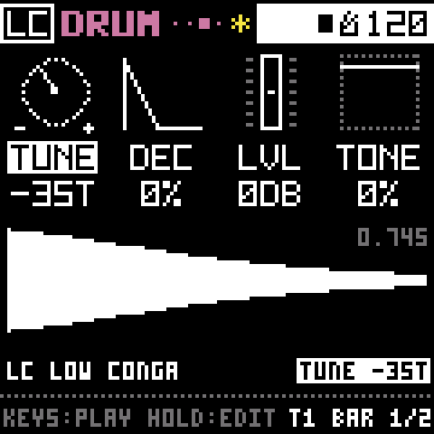

The **KIT** page (press **ENV**) does the same for the whole kit at once: TUNE, DEC, TONE, DRV.

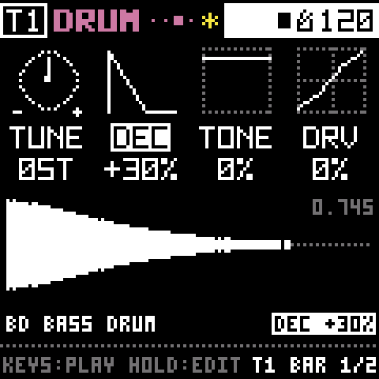

### 5.8 ARP: the arpeggiator

The arpeggiator plays the keys you hold **one note at a time, in time**. It works on every track: on **SYNTH and
POLY** it plays notes, on **TAPE** it steps through the slices you hold, and on **DRUM** it walks the drums you hold up
and down (hold BD, SD and CH with UPDN and you get BD SD CH SD BD...).

1. Press **ARP**.
2. Turn **KNOB 1 (MODE)** to **KEY**.
3. Hold a chord on the white keys.

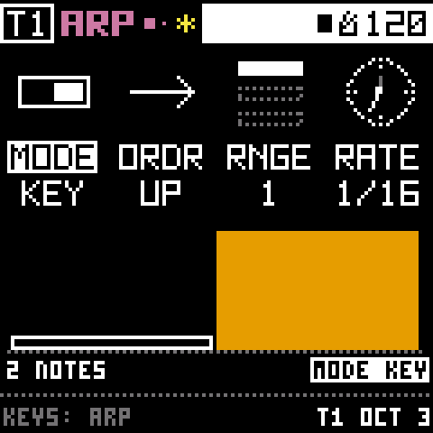

**You'll hear:** the notes of the chord one after another, a sixteenth each. The bars show the pattern; the solid one
is playing.

The knobs:

| Knob | Does |
| --- | --- |
| **MODE** | **OFF**; **KEY** plays while you hold keys; **LTCH** keeps playing the last chord after you let go (press a new chord to replace it); **ADD** keeps every key you press, so you can pile up an endless pattern; **HOLD** keeps the chord as LTCH does but plays it whole and sustained, no steps: a pad that's struck once and again only where the chord changes |
| **ORDR** | **UP**, **DOWN**, **UPDN** (up and back down), **RND** (random), **PLAY** (the order you pressed them) |
| **RNGE** | 1, 2 or 3 octaves: the notes, then the same an octave up, and so on (on TAPE and DRUM there's no octave of a slice or a drum, so it stays at 1) |
| **RATE** | how long each step is: 1/4, 1/8, 8T, 1/16, 16T, 1/32 (T is a triplet) |
| **GATE** (page 2) | how much of each step the note sounds: short and plucky, or long. Past 100 % (up to 400) each note keeps ringing into the steps after it, so the notes overlap into a wash (SYNTH and POLY; TAPE and DRUM stop at 100) |
| **SWNG** (page 2) | pushes every other step late |
| **GRND** (page 2) | each step's note length at random, up to GRND points either side of GATE, so the pattern breathes |
| **FADE** (page 2) | let every key go and the notes go on for this long, fading out (SYNTH, POLY). At 0, KEY stops the moment you let go and LTCH and ADD hold for good |

**To build an endless pattern:** set MODE to **ADD**, then press keys one at a time. Each one joins the pattern and
stays. **Hold black key POLY** (on the ARP page) to clear it and start again.

**To take a note out:** press its key again. Any note that plays on without its key (a latched chord, an ADD pile,
a fading chord) leaves when you press it; the rest keep going. In LTCH a key that isn't in the chord still starts a
new one, in ADD it joins.

**To let an arpeggio die away instead of stopping:** turn **FADE** (page 2) up. Let go of every key and the notes
keep stepping while their level falls to nothing over FADE. At the end KEY and LTCH forget the notes; ADD keeps its
pile, quiet, and any key brings it back at full. Any key during the fade brings the level back too. On TAPE and DRUM
tracks the steps can't fade under the reel or the pattern, so there FADE is how long the slices or drums keep stepping
after you let go.

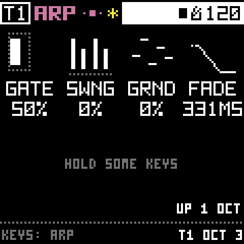 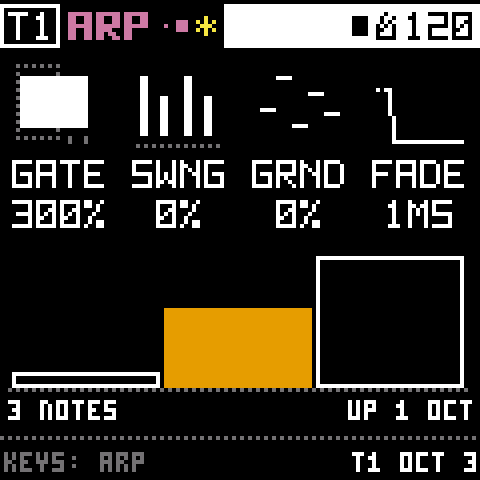

**The keys show the pattern:** while the arpeggiator is on, the key of each note it holds is lit, and the one sounding
goes dark for its step, so you can see the pattern walk and find the key to take a note out.

 

**RIPL ARP (the ARP pad's third page): an arpeggio for the strings.** Press ARP three times (or hold ARP and press
white key 3). It's RIPPLE's own arpeggio, separate from the track's: each step plucks RIPPLE's four strings at
that note (or, with RIPPLE's KEYS on TUNE, retunes it to that note), whatever the track plays. **MODE** turns it on (OFF, KEY, LTCH, ADD); **ORDR**, **RNGE** and **RATE** work
as above. With MODE on, the white keys on this page play the strings' pattern and the track itself stays quiet; with
MODE off they play the track as on the other ARP pages. A latched or piled-up pattern keeps plucking when you leave
the page, and **hold POLY** here to clear it. You'll want RIPPLE's **WET** up (EDIT seven times, KNOB 4) to hear it.

Keys you hold play straight away, transport or not. A latched or piled-up pattern keeps playing when you move to
another track, and follows the transport: **STOP** quiets it (the notes are kept), **PLAY** starts it again from the
top. Each track has its own, and a project you save keeps the notes it holds.

### 5.9 Play the black keys as notes

The FM-1's keys are laid out like a piano, F to G. Normally the black keys are shortcuts, and the white keys play
semitones in a row. You can make it a real keyboard instead:

1. **Hold GLO and press OCT+.** The screen says **BLACK KEYS PLAY NOTES**.
2. On a SYNTH or POLY track, the white keys now play the natural notes from F, and the black keys the sharps, like a
   piano. **OCT− / OCT+** still move it.
3. **Hold GLO and press OCT+** again to get the shortcuts back.

While the black keys are notes, **hold GLO** to use their shortcuts (mutes, reverse, clears, freeze): with GLO held
they're shortcuts again, and the OP keys light up for the muted tracks. Holding LFO and tapping
OP1–OP3 still works ([7.4](#74-choose-which-modulator-the-lfo-pad-controls)). The setting is also on the SETUP page
([3.7](#37-setup-how-the-panel-behaves)) and is kept when you turn the FM-1 off.

---

## 6. The effects

Every track goes through GRAIN, RIPPLE, COLOR and CHRONOS, in that order. They start switched off (WET at 0, DLY
and VERB at 0), so turn them up to hear them.

### 6.1 GRAIN: turn it on

GRAIN keeps the last bars of the track's sound and plays tiny pieces of it (grains), scattered and layered.

1. Press **PLAY**.
2. Press **EDIT**: **GRAIN 1**.
3. Turn **KNOB 4 (WET)** up to 80 %.

 

**You'll hear:** a cloud of the track's sound. Each block in the picture is a grain.

**How many grains:** under the picture, "5 OF 40 GRAINS" is how many are sounding and how many this track may have
right now. There's a pool of 40 for one track, 30 between two and 18 between three or four, and only tracks whose
grains you'd hear share it. A muted track doesn't, and neither does one with nothing in its buffer yet (a SYNTH or
POLY track nobody has played), or one reading the tape while the transport is stopped. A track alone has all 40; how
many actually sound is up to **RATE** and **SIZE** (more grains a second, or longer ones, overlap more), so turn those
up for a thicker cloud. To give a track a set number, whatever the others do, use **GRNS** on GRAIN 6 (6.4.2). When a
track has no grains, the page says why: **MUTED**, **STOPPED**, **SILENT**, or **TAKEN** (other tracks hold the
whole pool).

### 6.2 GRAIN: shape the grains

On **GRAIN 1** (press EDIT once):

- **SIZE**: how long each grain is.
- **RATE**: how many there are.
- **ROUT** and **WET**: how the grains mix in (6.8).

On **GRAIN 2**: **PTCH** their pitch in semitones, **SPRD** how wide in stereo, **SPRY** scatters where they
start, **CONT** softens their edges.

On **GRAIN 3**: **REV** plays some backwards, **PATN** the rhythm they fire in, **SCAL** holds their pitch to a scale
and **PRND** gives each a random pitch. SCAL's list is the same as the mixer's KEY page, with **KEY** first: the
grains then follow whatever scale the project is in (every semitone while KEY's SCAL is OFF), so one change on the
KEY page moves the grains too. The shift is held to the scale's intervals from the sound's own pitch.

 

### 6.3 GRAIN: freeze

- **Hold black key 0**: the grains loop the bars they have and stop listening. Let go to carry on.
- **Tap black key 0**: it stays frozen (its light is on) until you tap again.

**Try:** freeze, switch the track's source or mute it, then let go.

### 6.4 GRAIN: where the grains read

On **GRAIN 4**, **SCAN** chooses:

| SCAN | The grains read |
| --- | --- |
| **STR** (the default) | what just played, moving at **WARP**'s speed: below 100 % it falls behind and stretches time |
| **POS** | one spot, set by **OFST** |
| **DLY** | what played a moment ago (OFST sets how long ago): a granular delay |
| **TAPE** | straight from the track's tape |

**FDBK** feeds the grains back into themselves. On any GRAIN page, the **white keys move the reading spot** to their
sixteenth of the loop.

### 6.4.1 GRAIN: BODY, a floor under the grains

At WET 100 you hear only grains: the original sound is gone, and with it what held the cloud down. **GRAIN 5** puts a
floor back under them:

- **BODY**: how loud the floor is (0 is off). It goes with the grains, so WET turns it down too.
- **MODE**: what the floor is.
  - **SRC**: the track's own sound with its top taken off. Always in key and in time with what you're playing.
  - **TRI**: a triangle under every grain, at that grain's note. It's heard on the FM-1's own speaker too.
  - **SIN**: a sine under every grain: the purest, best on headphones (the speaker barely plays it when it's low).
- TRI and SIN give each grain a partial of its own: it starts with the grain, swells and fades with the grain's own
  window, and sits at the grain's note. With many grains overlapping, the body is a chord of what they play, with
  the grains' rhythm in it; with few, each grain thuds on its own note. Stop the transport and it stops with them.
- **ROOT**: where the partials sit (TRI and SIN), C1 to C5. Set it to the key you're in. Each follows its grain's
  note, so when **PTCH** (GRAIN 2), **PRND** and **SCAL** (GRAIN 3) send the grains around a scale, the body plays the
  same scale over ROOT. It always stays in the octave above ROOT, so it's a floor however high or low the grains go.
  With PTCH and PRND at 0 every partial is ROOT.
- **ROOT RES** (turn ROOT all the way down, below C1): the partials take RIPPLE's root instead (its PTCH, the white
  key you played on its page, or RIPL ARP's note), so BODY always rings the strings. RIPPLE's strings only answer
  the notes they're tuned to: a BODY a third away from them passes through without ringing them.
- **TONE**: how much top end the floor keeps, from a deep rumble to a full low-mid.

### 6.4.2 GRAIN: how many grains a track holds

**GRAIN 6** has **GRNS** (KNOB 1).

- **GRNS AUTO** (the default): the track shares the pool with the others, by what each one's RATE and SIZE ask for.
  Whatever nobody needs is shared out too, so a track alone has all 40.
- **GRNS 1 to 40**: the track holds that many. It takes them from the AUTO tracks first, and keeps them however the
  other tracks come and go, so its cloud doesn't thin when another track's GRAIN comes on. It never gets more than
  that number either. The page then reads "5 OF 12 HELD".
- The pool still shrinks as more tracks use grains (40, 30, 18): that's what the FM-1's processor can run. If the
  tracks holding numbers ask for more than the pool, they share it: the ones asking less keep theirs, the rest
  split what's left. An AUTO track left with nothing says **TAKEN: NO GRAINS**.
- GRNS sets how many may sound; **RATE** and **SIZE** still decide how many start. For a full 12, turn those up
  until the page reads "12 OF 12 HELD".

**SYNC** (KNOB 2 on GRAIN 6) puts the grains on the tempo: **RATE** then picks a division (1 bar, 1/2, 1/4, 1/8, 8T,
1/16, 16T, 1/32, 32T, 1/64) and a grain starts on each step of that grid, following the tempo as it changes. **PATN**
still shapes it: SWNG makes every other step late, CLST plays three quick grains then rests, RND puts each step's
grain somewhere inside it.

### 6.5 RIPPLE: strings, combs, resonators

The track rings through something tuned: four strings like a sitar's sympathetic strings, or one of three other
forms. Each track has its own.

1. Press **EDIT seven times** for **RIPPLE**.
2. Turn **KNOB 4 (WET)** up (KNOB 3 is ROUT, see 6.8).
3. Page 1 is what rings and its mix: **DEC** how long it rings (FDBK on COMB, RING on RESO and 12-BAND), **TONE**
   how bright (TILT on RESO and 12-BAND, which takes the upper bands down), then **ROUT** and **WET**.
4. **Hold EDIT and turn SELECT** to choose RIPPLE's form. Its name is in the header, and each form has its own
   picture, labels and pages:
   - **RIPPLE**: four strings, a Karplus-Strong loop each.
   - **COMB**: the same lines at half length, fed back inverted. Only the odd harmonics ring, giving a hollow,
     clarinet-like body at the same pitch.
   - **RESO**: four resonators, a resonant band on each of the chord's first four notes, as a filter rings.
   - **12-BAND**: twelve of those bands over the chord's notes, climbing through the octaves: a filter bank that
     sorts whatever comes in into the chord. The picture is a meter for each band.

   All four forms ring the track's own sound, and each comes out at about the level of what goes in, so turning WET
   up is a real change: a drum loop through 12-BAND is sorted into the chord's notes, through COMB it turns hollow
   and pitched. Switching clears what was ringing; the knobs stay as they are.
5. **RIPPLE 2** shapes the form you're on, so it changes with the form:
   - **RIPPLE** (strings): **SPRD RIPL DRV PICK**.
   - **COMB**: **POL SPRD RIPL DRV**. **POL** is the feedback's polarity: **ODD** (inverted: the odd harmonics, hollow,
     at the root) or **ALL** (as is: every harmonic, an octave up, brighter and more metallic).
   - **RESO** and **12-BAND**: **FOCS WDTH FLOW SPRD**. FOCS and WDTH are a spotlight on the bands: **WDTH** at 100
     lets every band ring; turn it down and only the bands near **FOCS** (left: the lowest, right: the highest) ring,
     the rest fade out. **FLOW** moves the spotlight by itself: turn it up and the sound walks up through the bands
     and back down, one part of the spectrum at a time, FLOW how fast (a round trip of 20 seconds at 1, under a
     second at 100). Narrow WDTH to hear it as a band walking the chord; at WDTH 100 it's a gentle lean. FOCS places
     the spotlight when FLOW is 0. **EVEN** (page 6, with VARY): the odd partials against the even ones (left: the
     1st, 3rd, 5th alone, a hollow set; right: the 2nd, 4th, 6th, an octave up and emptier in the middle).
   - **COMB's FLOW** (page 5, with MODE STRM VARY) bounces the comb itself through the spectrum: its pitch climbs
     from E1 to E7 and back down at the same rates, a flanger's sweep with the comb's teeth. While it flows the comb
     is free of PTCH, the keys and their chord, so you don't have to tune it to anything; SCAL still spreads the
     four lines from wherever it is (0: the harmonics). At FLOW 0 it's the tuned comb as before.
   - **SPRD**: on the strings and combs a detune across them, from the lowest a little flat to the highest a little
     sharp (half a semitone across at 100: a chorus, and with RIPL a slow shimmer); on RESO and 12-BAND it stretches
     or squeezes the spacing of the partials instead, up to 40 % either way, out of tune with itself like a bell or a
     drum skin.
   - **RIPL**: the pitches drift slowly, each a quarter turn behind the one below, so the drift runs across them
     like a ripple on water. It reaches up to half a semitone either way at 100 and gets faster as it rises.
   - **DRV**: a saturation in the loop, the way a Polivoks filter overdrives its own feedback. A loud ring rounds off
     and gains odd harmonics, warm and gritty; as it dies away it rings clean again. On the resonators it drives what
     reaches the bands (there it's on page 3). It starts at 25.
   - **PICK**: how hard a pluck strikes. Turn it left for a soft mallet (dark and round), right for a pick (bright
     and snappy).
6. **RIPPLE 3** is the pitch: **PTCH** the root, **SCAL** the chord the strings (or bands) make, then **KEYS** and
   **PLVL** (on RESO and 12-BAND: DRV and RIPL; their KEYS and PLVL are on page 5).
   - **SCAL**: **HARM** is the root's harmonics; then **MAJ**, **MIN**, **PEN**, **SUS2**, **SUS4**, **DOM7**, **MAJ7**,
     **MIN7** (the sevenths leave out the octave, because the seventh's rub is the point), **DIM**, **AUG**, **5TH** (a
     power chord) and **OCT** (one note in four octaves). The ring over the knob lights the notes.
   - **KEYS**: **PLCK** or **TUNE**.
     - **PLCK**: a white key on RIPPLE's page sets the root and plucks it. On a TAPE or DRUM track it plays without
       a slice or a drum, as a sound of its own. A RIPL ARP step plucks too.
     - **TUNE**: a key or a RIPL ARP step only sets the root, so what rings is the track's own sound, played in the
       keys' tune.

     On SYNTH and POLY the keys play the source either way, and RIPPLE follows its notes.
   - **PLVL**: how loud a pluck is (the keys' and RIPL ARP's), so it sits against the track's own sound.
7. **RIPPLE 4** is a filter in front (**CUT**, **RES**, **TYPE**): what of the track reaches it. Its KNOB 4 is
   **STRM** on the strings (strum: the strings sound one after another, lowest first, this many milliseconds apart;
   a new pluck cuts a strum that hasn't finished), **PICK** on COMB, **MODE** on RESO and 12-BAND.
8. **RIPPLE 5**: **MODE**, the form as a knob (the same as EDIT held + SELECT), and **VARY**: each pluck comes out a
   little different, in level and brightness. On COMB, STRM is here too. RESO and 12-BAND have a page 5 of the keys
   (**KEYS PLVL PICK STRM**) and a page 6 with VARY.
9. To play a pattern on it, use **RIPL ARP**, the ARP pad's third page ([5.8](#58-arp-the-arpeggiator)).

The picture shows it: while a string rings, the curve waves round its node in orange, as high as the string is
loud and as tight as it is high, and the waves drift along with RIPL. On 12-BAND each band's meter lights orange
as it rings.

  

  

### 6.6 COLOR: dirt and character

1. Press **FX**: **COLOR**.
2. **DRV** drives it, **CRSH** crushes it (lo-fi), and **ROUT** and **WET** mix it in.
3. **COLOR 2**: **NOIS** adds noise that rides on the sound, **TILT** makes it darker or brighter, then the noise's
   length and tone (NDEC, NTON).
4. **COLOR 3**: what CRSH crushes (CMOD: BIT, RATE, BOTH) and **LVL**, its level.

 

### 6.7 CHRONOS: echoes and a room

1. Press **FX four times**: **CHRONOS**. **TIME** is the echo's time, **FDBK** how many echoes; turn up **DLY** (the
   echoes) and **VERB** (how much goes to the room), its two sends. VERB follows the track's level: turn the track
   down or mute it and its share of the room goes with it.
2. Press **FX** again for **CHRONOS 2**, how the echoes sit:
   - **SYNC** puts the delay on the tempo: **TIME** then picks a division (1/64 to 1/2, with dotted and triplet
     ones) and the strip shows it. The delay line holds 370 ms, so a division longer than that at your tempo is
     halved until it fits (a 1/4 at 120 BPM plays as 1/8), which keeps it on the beat; the strip shows what plays.
   - **TONE** darkens or brightens the echoes, and **SPRD** spreads them across the stereo field.
   - **DUCK**: the echoes dip while the track plays and swell back in the gaps, so they stay out of your way.
3. **CHRONOS 3**, what the repeats become (both at 0: plain, clean echoes):
   - **AGE**: tape. Each repeat comes back a little more saturated and darker than the last, and the time wavers
     (a slow, wandering wow and a quick flutter: a clear warble at 100), so the echoes drift and wear like an old
     tape delay.
   - **DIFF**: each repeat is smeared a little more than the last, so the echoes melt into a wash.
4. **CHRONOS 4**, the room: **ROOM** picks which room the track sends to, **A** or **B**; then that room's **TYPE**:
   **ROOM** (as before), **PLAT** (a plate: dense and bright), **HALL** (long and dark), **SPRG** (a spring: short,
   bright and ringing); its **SIZE**; and **DEC**, how long it rings.
5. **CHRONOS 5**, the room's finer points: **PRE** (a gap before it starts), **RTON** (its tone), **MOD** (the tail
   wavers slowly, so it sounds less metallic and more alive) and **QUAL**: **HI** (the full 22 kHz) or **LO** (half
   the rate: half the CPU, and a darker, softer tail that suits a big ambient room).

Bryo has two rooms, A and B, and the tracks share them: tracks 1-2 start on A, 3-4 on B. A room costs the same
whether one track or four send to it, so a room per pair is the cheap way to put everything in a space. The room's
knobs on CHRONOS 4 and 5 (all but ROOM itself) belong to the room, so turning them on one track changes it for every
track on it; the label under the picture names the others when there are any ("B: T1 T2"). They're saved with the
project, and they can't be modulated (the room is shared). A track preset keeps the track's room choice.

   

### 6.8 Insert or send

GRAIN, RIPPLE and COLOR have **ROUT** on KNOB 3 of their first page, next to WET:

- **INS** (insert): **WET** fades from the dry sound to the effect.
- **SEND**: the dry sound stays at full and WET adds the effect on top.

CHRONOS always works as a send.

---

## 7. Modulation

Each track has **four modulators**. A modulator makes knobs move by themselves.

- **M1, M2, M3** live on the **LFO** pad (hold LFO and tap OP1, OP2 or OP3 to choose). Each can be an **LFO** (a
  wave), an **ADSR** (an envelope), a **SEQ** (steps) or a **FOLLOW** (follows how loud a track is). Out of the box:
  M1 is a slow LFO, M2 an envelope, M3 a random LFO.
- (**ENV** isn't a modulator: it opens the track's own envelope and filter pages.)
- **M4** is the step sequencer, on the **SEQ** pad.

### 7.1 Make a knob move

Let's make COLOR's crush breathe.

1. Press **PLAY**, then **FX** (COLOR).
2. **Hold LFO.** The knobs now show depths (how much M1 moves each one).
3. While holding it, **turn KNOB 2 (CRSH)** to about **+40 %**.
4. Let go.

While the pad is held the footer counts the modulator's depths, **DEPTH 1/12**: each modulator can move up to
twelve knobs, and a track holds thirty-two depths in all. Past a dozen the knob is refused with a message; hold the
pad and **MONO** to clear that modulator's depths on the page, or turn one back to 0.

**You'll hear:** the crush coming and going, slowly. That's it: **hold a slot, turn a knob**. It works on any page
of the track: the source, the effects, the channel strip.

### 7.2 See what's moving

After you let go, a modulated knob has a **mark under it**: a rail showing how far it reaches, and where it is now.

### 7.3 Change how the modulator moves

1. **Tap LFO** (press and let go). M1's own page opens.
2. **RATE** is how fast, in time with the tempo (1/2: once every half bar), **SHPE** the shape (SIN TRI SQR SAW RND), **SKEW** and **FOLD** bend
   it. The picture is **2 bars** of time (a tick a beat; **4 seconds** with SYNC off, a tick a second), so turning
   RATE changes how many cycles you see.
3. **Tap LFO again** for its other pages. The last one has **AMT** (how much it moves everything) and **OFS** (an
   offset).
4. **SPRD** (on every modulator) moves the right side differently from the left: on an LFO the right side runs
   ahead in its cycle, on ADSR, SEQ and FOLLOW it lags behind. It reaches the knobs that work on the two sides
   separately: **PAN** (each side's own balance), the channel's **LOW HIGH FILT**, and COLOR's **DRV CRSH TILT**.
   An LFO on FILT with SPRD up sweeps the filter one way on the left and the other on the right, so the sound moves
   across the stereo field. At 0 both sides move together.

 

### 7.4 Choose which modulator the LFO pad controls

1. **Hold LFO.**
2. While holding it, **tap black key OP1, OP2 or OP3**: M1, M2 or M3. The screen says which.
3. Turn a knob now to set that modulator's depth, or let go of LFO to see its page.

From then on, LFO is that modulator, until you pick another.

### 7.5 Change a modulator's engine

M1, M2 and M3 can each be **LFO**, **ADSR** (an envelope the keys, the arpeggiator or the loop set off), **SEQ** or
**FOLLOW**.

1. **Hold LFO** (with the modulator you want chosen: hold LFO and tap OP1-OP3).
2. **Turn SELECT** to pick the engine.

Its depths stay where they were (the message says how many: "M1 IS ADSR, 4 DEPTHS KEPT"). M4 always stays the
step sequencer.

 

**FOLLOW levels itself:** it measures each track against that track's own recent loudest, so a quiet pad or
tape pushes its knobs as far as a loud drum does. **GAIN** works on top: up and it reaches the top sooner (more
pumping), down for a gentler push. Near-silence stays at the bottom.

**FOLLOW's picture:** on a TAPE track it previews the follower over the tape's loop. On SYNTH, POLY and DRUM, which
have no tape to preview, it shows the last second and a half live: what it hears (dim bars) and what it gives (the
line), **LIVE** in the corner. It runs while its page is up even before it moves any knob, so you can set RISE, FALL
and GAIN by watching it, then give it a depth.

### 7.6 SEQ: set the steps

1. **Tap SEQ** for M4's page.
2. **Hold a white key** (key 1 is step 1) and **turn KNOB 1**: that step's value.
3. Hold several keys to set them together.
4. **LEN** is how many steps; **RATE** how long each one is.
5. The white keys show it: the steps inside LEN glow, and while it plays the step playing is **lit** (held keys are
   lit too). It runs while its page is on screen even before it modulates anything, so you can watch it as you
   write the steps.

### 7.6.1 P-locks: a depth for one step

The SEQ's depth to a knob is the same on every step. A **p-lock** gives one step its own depth, so a single step can
open the filter, throw a grain cloud wide, or do nothing at all while the rest of the pattern does its usual thing.

1. Go to the page with the knob you want (GRAIN, the filter, any of them).
2. **Hold SEQ**, then **hold the white key of the step** (key 5 is step 5).
3. **Turn the knob.** That step's depth moves; the others stay where they were. The value under each knob shows
   that step's depth: bright where it's locked, dim where it's the SEQ's own. The footer says which step.
4. Let go. Hold several step keys at once to lock them together.

A lock can be any depth, 0 too (that step does nothing). Turn a lock back to the SEQ's own depth and it's gone.
Locks work without any SEQ depth on the knob at all: the step moves it, the rest leave it alone. A track holds up to
32 locks over up to 8 knobs. MONO clears them with the depths (SAVE held brings them back), they're saved with the
project, and a track preset doesn't carry them (loading one clears the track's).

With SEQ held, a white key you tap without turning a knob still jumps to SEQ's page, as it's let go.

### 7.7 Clear modulation

- **Hold black key MONO** half a second: every depth on the track is cleared (the slots' own settings stay).
- **Hold a modulator's pad and MONO**: only that modulator's depths on the page you're on.
- **Hold SAVE** to undo.
- Or turn one depth back to 0: it stops there, so it's easy to find.

---

## 8. Getting back

### 8.1 Reset one knob

**Hold SCL and turn a knob.** It goes back to its default.

### 8.2 Reset a whole page

**Hold SCL and press the page's own pad** (the lit one: HOME on a source page, EDIT on GRAIN, FX on COLOR...).
Every knob on that page goes back to its default.

### 8.3 Undo

**Hold SAVE.** It puts back the last thing you reset, cleared or loaded.

---

## 9. Saving

### 9.1 Save everything

**Tap SAVE.** Everything is saved into the current project (**P1** to start with): every knob, source, pattern,
depth, the mixer and the tempo. A tape you recorded goes into a user reel named after the project and the track
(**P1T2** is project 1, track 2); if all six user reels are taken, SAVE tells you which tapes didn't fit. The last
project you saved comes back when you turn the FM-1 on.

**Saving while it plays:** the sound carries on. When there's a new recording to keep, the sound fades out for a
moment while it's written, then fades back in. (Bryo gets the next save ready in a quiet moment, when the transport
is stopped and nothing sounds, so a save mid-performance doesn't have to stop the sound.)

### 9.2 Projects: save, load, delete

There are six project slots, P1 to P6.

1. Turn **PRESETS**. The **PROJECTS** view opens.
2. Turn **PRESETS** to point at a slot.
3. Then:
   - **OCT+** loads it. (If you have changes you haven't saved, press OCT+ again within 3 seconds to confirm.)
   - **SAVE** saves into it. (Over another project, press SAVE again within 3 seconds.)
   - **Hold POLY** half a second to delete it.
   - **OCT−** to leave.

### 9.3 Start a new, blank project

1. Turn **PRESETS** and point at an **EMPTY** slot.
2. Press **OCT+**. (If you have changes you haven't saved, press it again within 3 seconds.)
3. Everything starts from nothing: every track an empty tape, no reels, no drum pattern, no modulation, 120 BPM.
4. **Tap SAVE** when you want to keep it: it saves into that slot.

### 9.4 Back to the factory scene

The scene Bryo starts with is always there, even after you've saved over it:

1. Turn **PRESETS**, and keep turning past **P6**: **F, FACTORY**.
2. Press **OCT+**. (Changes not saved: press it again within 3 seconds.)
3. The factory scene plays. Your projects in P1 to P6 are left exactly as they were.
4. To keep your changes to it, turn **PRESETS** to a slot and press **SAVE**.

One more step past FACTORY is **T, TEST**: the factory scene set to **GLITCH**, where every stage of the chain is
at work. It's for
comparing one firmware with the next: load it, press **PLAY**, give it a few seconds, and read the CPU and SETUP's
load lines. It plays the same every time, so the numbers compare.

### 9.5 Track presets: keep one track's sound

A track preset is **a track's sound**: its source and knobs, the effects, the channel strip and the modulation. Not
its pattern, level, REC IN or arpeggiator.

1. Turn **PRESETS**, then press **EDIT**: the **PRESETS** page, eight slots **A to H**.
2. Turn **PRESETS** to a slot.
3. **SAVE** saves the track you're on into it. **OCT+** loads it into the track you're on.
4. Changed your mind after loading? **Hold SAVE** to put the track back.

### 9.6 Factory presets

Past H come eight factory presets, two for each source: **DRIFT** and **RINGS** (TAPE), **BASS** and **PAD**
(SYNTH), **KEYS** and **SWELL** (POLY), **TIGHT** and **DUB** (DRUM). Load one into a track of that source with
**OCT+**.

### 9.7 Your reels: see and delete them

Your six user reels (U1 to U6) hold the takes your projects saved and the WAVs you copied in. A project saved with a
take keeps pointing at its reel, so deleting a project leaves its reels; delete them here.

1. Turn **PRESETS**, then press **EDIT twice**: the **REELS** page.
2. Turn **PRESETS** to a reel. The strip shows its name, its length, and which tracks play it right now. A reel longer
   than 3.3 seconds runs on into the slots after it, shown as (CONT.).
3. **Hold POLY** half a second to delete it (from any of its slots). A track playing it goes silent; a project that
   names it plays nothing there. There's no undo.

---

## 10. With a computer

### 10.1 Copy sounds on and off

Plugged into a computer, the FM-1 shows up as a small drive called **BRYO**.

- **Copy a track off:** `TAPE1.WAV` to `TAPE4.WAV` are what each track plays.
- **Replace a track's tape:** copy a WAV on, named `TAPE2.WAV` for track 2 (and so on).
- **Add a reel:** a WAV with any other name becomes one of six user reels (up to 21.5 s). Pick it with REEL
  ([2.5](#25-play-a-different-reel)). Deleting the file on the computer doesn't delete the reel: do that on the
  REELS page ([9.7](#97-your-reels-see-and-delete-them)).
- **Eject the drive and plug it back in** to see new files.

### 10.2 Record what the computer plays

1. With the FM-1 stopped, **hold REC for a second**. The **USB RECORD** screen opens.
2. On the computer, pick **Bryo** as the sound output and play something.
3. Press **REC** to start the take and **REC** to stop it.
4. Trim it while it loops: **STRT** and **LEN** (the part you keep), **GAIN**, **FADE** (the ends).
5. Press **white key 1 to 4** for the track it goes on, then **REC** to keep it.
6. **HOME** goes back a step (throws the take away, or leaves).

  

---

## 11. When something goes wrong

### 11.1 A red BRYO CRASH screen

It restarts by itself after 4 seconds. What was only in memory (anything unsaved) is gone; saved projects, reels
and settings stay. If it freezes instead, it restarts after 8 seconds. If it crashes twice within 30 seconds of
turning on, it starts in update mode so it can be reinstalled.

Please write down what you were doing: it helps find the bug.

### 11.2 UPDATE MODE IN 3...

You're holding **OCT− and OCT+ together**. Holding them five seconds puts the FM-1 in update mode, to install
firmware. **Let go** to cancel.

### 11.3 A calibration screen

OCT− and OCT+ were held while it turned on. Follow the screen (press each button, turn each knob), or turn it off
and on again.

### 11.4 Going back to the original firmware

M-VAVE's updater puts the stock firmware back. Bryo's projects and tapes can't be opened there.

---

## 12. Quick reference

| Do this | To |
| --- | --- |
| **PLAY** | start / stop |
| **SELECT** | tempo |
| **MASTER** | volume |
| **GLO** held + white key 1-4 | pick a track |
| **GLO** tapped, **EDIT** | SCENES: white key 1-4 recalls (held + SAVE stores), KNOB 1-4 morphs |
| **GLO** held + KNOB 1-4 | track levels |
| **GLO** held + SELECT | how many tracks are on |
| **GLO** tapped, then **EDIT** | SCENES, CHANNEL, MASTER, KEY, SETUP |
| **OP1-OP4** | mute tracks |
| **OP5 / OP6** | the tape backwards / half speed |
| **HOME** | the source's pages |
| **HOME** held + SELECT | change the source |
| **EDIT** held + SELECT | RIPPLE's form (RIPPLE, COMB, RESO, 12-BAND) |
| **EDIT** | GRAIN, then RIPPLE |
| **FX** | COLOR, then CHRONOS |
| **ENV** | the source's shaping pages (envelope, filter, kit) |
| **LFO SEQ** tapped | that modulator's pages (LFO: M1-M3, SEQ: M4) |
| **LFO SEQ** held + a knob | how much that modulator moves the knob |
| **LFO** held + OP1 / OP2 / OP3 | which modulator LFO is: M1, M2, M3 |
| **LFO** held + SELECT | the modulator's engine (LFO, ADSR, SEQ, FOLLOW) |
| **ARP** | the arpeggiator (notes on SYNTH and POLY, slices on TAPE, drums on DRUM); its page 3, RIPL ARP, plays RIPPLE's strings |
| **GLO** held + OCT+ | black keys: shortcuts or notes |
| **GLO** tapped, **EDIT** ×5 | SETUP: keys, knob speed, hold time, LEDs |
| **REC** | record onto the track |
| **REC** held 1 s, stopped | record the computer |
| **ALGORITHM** | what REC records |
| black **POLY** held | clear the tape (DRUM: the pattern) |
| black **MONO** held | clear the track's modulation |
| black **0** | freeze GRAIN (held, or tapped to latch) |
| **SCL** held + a knob | that knob to its default |
| **SCL** held + the lit pad | the page to its defaults |
| **SAVE** | save the project |
| **SAVE** held | undo the last clear, reset or load |
| **PRESETS** | projects; then EDIT for track presets, EDIT again for your reels |
| **PRESETS**, an empty slot, **OCT+** | a new, blank project |
| **PRESETS** past P6 (FACTORY), **OCT+** | the factory scene back |
| **OCT− / OCT+** | octave (DRUM's pages: the bar) |
